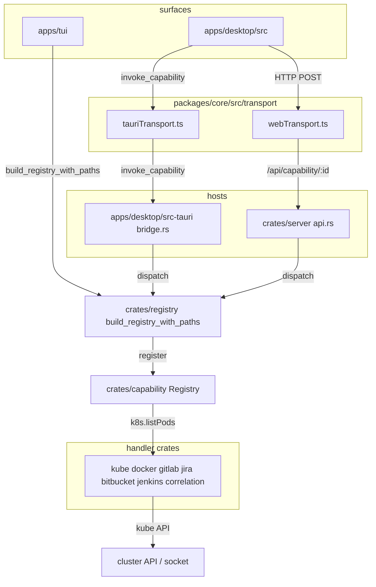
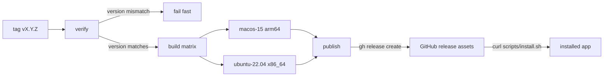

# Architecture diagrams

A diagram is a claim about the code. Keep it small, traceable and checkable. The
canonical map for this repo is `docs/ARCHITECTURE.md` — link, do not restate.

## 1. Pick the level first

One diagram answers one question. Pick exactly one level:

| Level | Question it answers | Repo example |
|---|---|---|
| System context | Who talks to what, outside the code? | user → desktop app → cluster |
| Layer / container | Which module calls which? | surfaces → transport → registry → crates |
| Request / sequence | What happens in one call? | `invoke_capability("k8s.listPods")` |
| Lifecycle / state | What states can a thing be in? | widget compact/hover/pinned/expanded |
| Pipeline | What runs between two milestones? | tag → verify → build → publish → install |

Never draw two levels on one canvas. If a box needs its internals shown, split
the diagram in two and link them by name.

## 2. Evidence rule

Every node and edge is traceable to a file, symbol or workflow line. Put the
source under the diagram or in the caption:

```text
Source: apps/desktop/src-tauri/src/bridge.rs:16, crates/registry/src/lib.rs:192
```

- A node is a real module, crate or directory — not a product.
- An edge is a real call, event or data path, labelled with its name.
- If you inferred an edge, draw it dashed and label it `inferred`.
- Never draw a box for something you did not find in the repo.

## 3. Format choice — first fit wins

1. **Mermaid** for flow, sequence, state and dependency. Renders as ASCII in a
   terminal, as an image on GitHub, and is diffable.
2. **SVG** only when mermaid cannot express the geometry: layout, panels, UI
   mockups. Use `currentColor` and the theme vars
   `var(--fg)`, `var(--muted)`, `var(--border)`, `var(--surface)`,
   `var(--accent)`, `var(--success)`, `var(--warning)`, `var(--error)`.
   No background fill, no scripts.
3. **Markdown table** when the content is comparable rows — not a graph.
4. **Prose** when there is one dependency; a diagram would be ceremony.

Never present the same content in two formats.

## 4. Density

- Under ~15 nodes. If it does not fit, split by level.
- Group with `subgraph` named after real directories: `crates/kube`,
  `packages/core/src/transport`.
- Label every edge with the call or event: `invoke_capability`, `EventSink`,
  `k8s.listPods`, `build_registry_with_paths`.
- No decorative nodes, no legend explaining colours that carry no meaning.

## 5. Anti-patterns

- **The everything-diagram**: every crate plus every HTTP call on one canvas.
  Unreadable and unmaintainable; split it.
- **Product-name boxes**: `Kubernetes` instead of `crates/kube`. Name modules.
- **Arrows without verbs**: an unlabelled edge is a guess.
- **Diagram duplicating a table** already in the doc. Keep one.
- **Unescaped syntax in mermaid text**: `(`, `{`, `"` break rendering. Use
  quotes around node text: `A["fetch pods"]`.
- **Stale diagram after a rename**: regenerate from the new code. Never patch
  labels to match a memory of the old shape.

## 6. Verify before shipping

1. Mermaid: run the parser —
   `npx @mermaid-js/mermaid-cli -i d.mmd -o /tmp/d.svg`. A parse error is a
   failed diagram.
2. SVG: open it and look at it at both themes.
3. Walk every arrow against the code one last time.
4. Re-check paths with `ls` or `rg` before citing them.

A wrong diagram is worse than none. Both mermaid blocks below were rendered with
mermaid-cli 11.4.2.

## 7. Recipes for this repo

### a. Layer diagram — one capability call



Source: `crates/registry/src/lib.rs`, `crates/capability/src/lib.rs`,
`apps/desktop/src-tauri/src/bridge.rs`, `apps/tui/src/agent.rs`.

### b. Release pipeline



Source: `.github/workflows/desktop-release.yml` jobs `verify`, `build`,
`publish`; `scripts/install.sh`.

For anything wider than these, read `docs/ARCHITECTURE.md` first and draw only
the slice your question needs.
