# AllSpace

AllSpace is a delivery-first, local DevOps workspace: a prototype desktop app
that joins a work item to its change, build, artifact, deployment, and runtime in
one place. It runs as a Tauri v2 shell over a React 19 workspace and a Rust
capability core.

## What it does

- **One board per profile** — a single screen of compact widgets for Jira, Git,
  CI/CD, Kubernetes and the local Docker engine. Each widget
  expands on hover, stays open when pinned, and can take the whole board.
- **Shared context** — selecting a Jira issue, merge request, build or cluster
  resource becomes the context for its neighbours, so the window moves from the
  whole infrastructure to one object without leaving the screen.
- **Delivery Trace** — work item → change → build → artifact → deployment →
  runtime, joined from provider data with explicit evidence and confidence. The
  Trace widget is the join; other widgets are views onto the same context.
- **Working profiles** — each profile owns its Jira/GitLab/Bitbucket/Jenkins
  connections, kubeconfigs and namespaces, project filters, widget layout and
  refresh settings. Switching profiles isolates data, caches, in-flight calls
  and Kubernetes contexts.
- **Provider adapters** — Jira, GitLab, Bitbucket, and Jenkins feed a
  provider-neutral delivery model.
- **Kubernetes depth** — the Kubernetes explorer opens as a contextual
  drill-down from the board or a trace, over local kubeconfig credentials.
- **MCP access** — the same capability registry is exposed to MCP-capable
  clients over stdio or loopback HTTP.
- **Partial results stay partial** — a failed provider or cluster call is
  reported as a source error on a partial trace, never as a fact about the
  cluster or pipeline.

## Architecture

AllSpace runs a React 19 workspace inside a Tauri v2 shell. The UI calls Tauri
commands and receives events; the headless web host exposes the same
capabilities over HTTP and WebSocket; and the MCP server, also embedded by the
TUI, answers over stdio or loopback HTTP. Each host assembles the same
Tauri-free capability registry, so a capability is registered once and reached
from every surface.



The diagram shows integration modules, not the external services they call:
Jira, GitLab, Bitbucket, Jenkins, and the Kubernetes API sit outside the
boundary. Arrows are dependencies, not a full network topology. The
[diagram source (HTML)](docs/assets/allspace-architecture.html) is the editable
file; GitHub serves it as source, not as a live interactive page.

Kubernetes work goes through `crates/kube` and `crates/streams` — clients,
watches, logs, exec, port forwarding, Helm, and metrics. Delivery work is
provider-neutral: `crates/devops-model` defines anchors, entities, edges, and a
`Trace`; the Jira, GitLab, Bitbucket, and Jenkins adapters return entities; and
`crates/correlation` joins them with explicit evidence and confidence. A failed
source stays in `sourceErrors` on a partial trace rather than becoming a fact
about the cluster or pipeline.

The primary composition is the Home board: compact widgets for Summary, Delivery
Trace, Jira, Git, CI/CD, Kubernetes and Docker. The Docker widget reads this
machine's own engine socket and says plainly when none answers, instead of
showing an empty board. Widgets share one selection, so the Trace shows the chain for
whatever the reader picked. The Deliveries screen keeps its list and selected
Trace side by side, and Kubernetes opens as a contextual drill-down from a
widget or a trace.

Repository layout:

```text
apps/
  desktop/              React workspace and Tauri v2 shell (src-tauri/)
  tui/                  Terminal UI
packages/
  core/                 Shared TypeScript service layer and capability wrappers
  ui-kit/               Design-system primitives
  ui-next/              Next-design surfaces and routes
crates/
  capability/           Capability and registry types
  registry/             Capability assembly, catalog, and MCP kind resolution
  kube/                 Kubernetes clients, watches, actions, Helm, and metrics
  streams/              Exec, logs, port-forward, terminal, Helm, and watch streams
  devops-model/         Provider-neutral delivery entities, edges, and Trace
  correlation/          Anchor joins, evidence, situations, and trace capabilities
  jira/                 Jira adapter
  gitlab/               GitLab adapter
  bitbucket/            Bitbucket adapter
  jenkins/              Jenkins adapter
  docker/               Read-only local Docker-compatible engine (socket reads)
  mcp/                  MCP server over stdio and loopback HTTP
  server/               Headless web host
docs/                   Installation, usage, development, and project documentation
```

## Install

Install the latest release, or remove it again:

```sh
curl -fsSL https://raw.githubusercontent.com/1tuz/AllSpace/main/scripts/install.sh | bash
```

```sh
curl -fsSL https://raw.githubusercontent.com/1tuz/AllSpace/main/scripts/uninstall.sh | bash
```

The installer places `~/Applications/srelens.app` on macOS Apple Silicon and
installs the `.deb` on Linux x86_64; those are the only supported targets. The
builds are unsigned and not notarized, and carry no updater feed. Uninstalling
removes the application and leaves configuration and cluster credentials
untouched. To download an asset by hand, use the
[releases page](https://github.com/1tuz/AllSpace/releases).

## Setup

Prerequisites:

- [Rust](https://rustup.rs) stable
- [Node.js](https://nodejs.org) 26 (Node 24 LTS is also supported); `nvm install && nvm use` reads `.nvmrc`
- [pnpm](https://pnpm.io) 11+ (the exact version is pinned by `packageManager` in `package.json`)
- [Tauri v2 system dependencies](https://v2.tauri.app/start/prerequisites/)
- A reachable Kubernetes cluster for cluster-dependent workflows

Run from source:

```sh
git clone https://github.com/1tuz/AllSpace
cd AllSpace
pnpm install
pnpm dev
```

See the [developer guide](docs/DEVELOPMENT.md) for architecture, testing
standards, and instructions for adding capabilities, and the
[user guide](docs/USAGE.md) for using the app.

## Build and test

| Command | Purpose |
| --- | --- |
| `pnpm dev` | Launch the desktop application in development mode |
| `pnpm test` | Run JavaScript and TypeScript tests |
| `cargo test` | Run Rust workspace tests |
| `pnpm build` | Build the production frontend |
| `pnpm tauri build` | Create packaged desktop binaries |

## Status

AllSpace is a prototype. Tag-triggered unsigned desktop releases are published
to this repository by
[`.github/workflows/desktop-release.yml`](.github/workflows/desktop-release.yml);
CI also builds unsigned bundles for local testing from
[Actions](https://github.com/1tuz/AllSpace/actions/workflows/desktop-build.yml).
Release builds are not notarized and carry no updater feed. Installers from the
upstream project are not AllSpace releases.

## Naming

The Rust crates (`srelens-*`), TypeScript packages (`@srelens/*`), the
`srelens` binary and bundle identifier (`app.srelens.desktop`), and
configuration keys such as `SRELENS_MASTER_KEY` and `srelens.design` keep their
upstream identifiers so code paths, commands, and existing configuration stay
valid. They are internal identifiers; the product is AllSpace.

## License

AllSpace is open source under the [MIT License](LICENSE). The upstream copyright
notice is retained unchanged.

## Credits

- [srelens/srelens](https://github.com/srelens/srelens) — the MIT-licensed code
  foundation: Tauri v2 shell, React frontend, Rust capability registry,
  Kubernetes watch and stream layer, and MCP server.
- [Salience](https://github.com/clegginabox/salience-macos) — product and UX
  inspiration: joined unit-of-work context, My Work, and compact master/detail
  density. Credited as a design reference, not as a source-code dependency.
