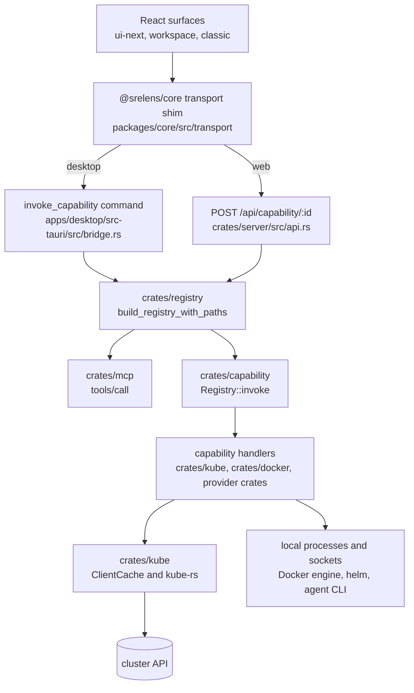
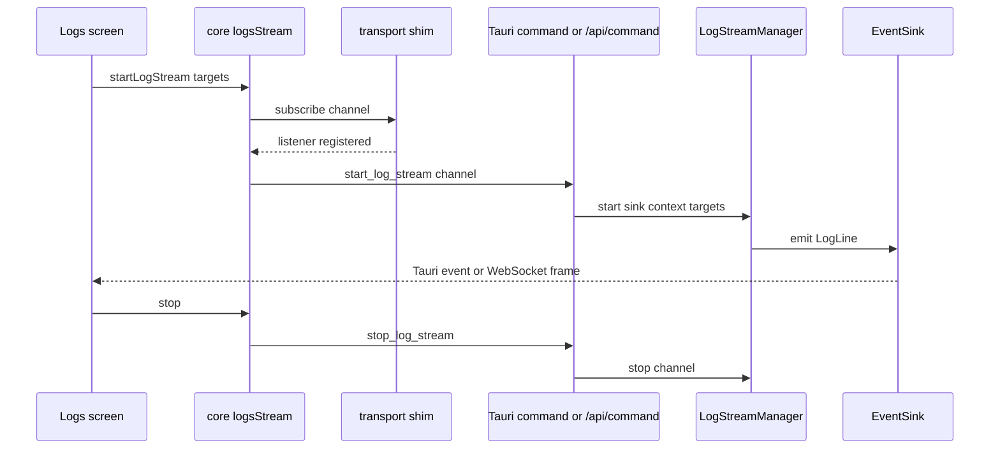

# AllSpace architecture

## Surfaces

AllSpace is one Rust capability backend behind several frontends. The default desktop shell is the delivery-first workspace board in `apps/desktop/src/workspace/` (`AppGate.tsx:21` defaults to it); the classic Kubernetes IDE in `apps/desktop/src/App.tsx` plus `apps/desktop/src/components/` is selected with `srelens.productSurface=classic` (`AppGate.tsx:16`); the opt-in ui-next redesign loads only when `srelens.design=next` (`apps/desktop/src/design.ts:17-26`, dynamic import in `main.tsx:41-60`). `apps/tui` is a separate terminal client. Three hosts expose that backend: the Tauri desktop app (`apps/desktop/src-tauri`), the web server (`crates/server`), and the MCP server (`crates/mcp`, run by the desktop binary's headless `--mcp-stdio` / `--mcp-http` flags, `main.rs:85-97`).

## Layers

Requests flow one way: UI code calls the core data layer; the data layer calls the desktop or web entry point; both dispatch into the same registry, which also backs MCP. `packages/core/src/transport/transport.ts:8` is the only load-time switch between hosts, so `@tauri-apps/api` imports stay confined to that directory (depth: [DEVELOPMENT.md](DEVELOPMENT.md#the-transport-shim)).

## Request path

Read — a pod list in a namespace:

1. A screen calls the core wrapper `listPods` (`packages/core/src/lib/workloads.ts:108-115`). Components never call the transport directly.
2. The wrapper calls `invokeCapability("k8s.listPods", { context, namespace })`. The shim (`packages/core/src/transport/transport.ts:8`) picked `tauriTransport.ts:9` at load (`invoke("invoke_capability", { id, input })`) or `webTransport.ts:45` (`POST /api/capability/:id`).
3. Desktop: the Tauri command in `apps/desktop/src-tauri/src/bridge.rs:16` takes the `AppRegistry` state and calls `Registry::invoke`. `apps/desktop/src-tauri/src/capabilities.rs` is only a re-export of `srelens-registry`. Web: `crates/server/src/api.rs:64` dispatches into the same registry from the per-user environment, after `WEB_DENIED_CAPABILITIES` (`api.rs:28`).
4. The registry was assembled by `build_registry_with_paths` (`crates/registry/src/lib.rs:192`); this id is registered at `crates/registry/src/lib.rs:290`.
5. `Registry::invoke` (`crates/capability/src/lib.rs:112`) finds the handler, deserializes the input, and awaits it.
6. `list_pods_capability` (`crates/kube/src/workloads.rs:305`) gets a client from `ClientCache` and lists through kube-rs. JSON travels back up the same path.

Write — delete a resource:

1. `DetailActions.tsx` shows a `ConfirmDialog` (`DetailActions.tsx:305`) and then calls `deleteResource` (`packages/core/src/lib/actions.ts:22`).
2. Same transport, same three surfaces: capability `k8s.deleteResource`, registered at `crates/registry/src/lib.rs:363`.
3. The handler is `delete_resource_capability` (`crates/kube/src/actions.rs:183`) annotated `Annotations::DESTRUCTIVE`.

**Consent rule.** A capability is a `Capability` with four annotations (`crates/capability/src/annotations.rs:12-25`); `DESTRUCTIVE` and `MUTATING` both set `read_only: false` and `requires_confirm: true`. Every capability that is not `read_only` MUST be `requires_confirm`, asserted by `assert_mutating_capabilities_are_gated` (`crates/mcp/src/completeness.rs:36`) and called from `every_capability_is_mcp_exposed` (`crates/registry/src/lib.rs:687-692`), so an ungated mutating capability fails `cargo test`. MCP additionally gates each call at runtime (`McpServer::requires_confirm`, `crates/mcp/src/lib.rs:160`). Desktop dialogs are UX, not a security boundary; the web host denies unsafe ids explicitly in `WEB_DENIED_CAPABILITIES` (`crates/server/src/api.rs:28`).

## Long-lived streams

Streams do not fit request/response. The logic lives in `crates/streams/src`, one manager per kind — `logs.rs:54` (`LogStreamManager`), `exec.rs:31` (`ExecManager`), `watch.rs:15` (`WatchManager`), `forward.rs:335` (`ForwardManager`), `helm.rs:30` (`HelmManager`), `terminal.rs:31` (`TerminalManager`). Each emits into the `EventSink` trait (`crates/streams/src/sink.rs:8`), implemented by `TauriSink` over Tauri events (`apps/desktop/src-tauri/src/sink.rs:11`) and by `WsSink` over WebSocket frames (`crates/server/src/ws/hub.rs:151-160`). Hosts expose them as commands: Tauri `start_log_stream` (`apps/desktop/src-tauri/src/logs.rs:20`) and `POST /api/command/:command` (`crates/server/src/api_command.rs:239`). The frontend half is shared: `packages/core/src/lib/logsStream.ts:47`, `exec.ts`, `watch.ts`, `forward.ts`, `helm.ts`.

The subscription is registered *before* the producer starts (`logsStream.ts:57`) so the initial tail cannot race the listener. On web, `subscribe` waits for the socket's `subbed` ack (`packages/core/src/transport/wsClient.ts:99`); on desktop it is a Tauri `listen`. Channel names are caller-supplied and per-session.

## Crates

All 19 workspace members from the root `Cargo.toml`. Library crates carry no `description` field, so roles are read from their module docs and code.

| Member | Role |
| --- | --- |
| `crates/plugin-host` | Native extension contract and declarative capability broker; loads no package code (`src/lib.rs:1-4`). |
| `crates/agent` | Normalizes supported agent-CLI streaming output into one `AgentEvent` stream; pure, no Tauri or cluster I/O (`src/lib.rs:1-2`). |
| `crates/capability` | The `Capability` type, safety annotations, and `Registry`; no Kubernetes knowledge. |
| `crates/mcp` | MCP server: registry-backed tools, prompts, `k8s://` resources, watch subscriptions, consent policy, token auth, audit log. |
| `crates/kube` | All Kubernetes: kubeconfig discovery, `ClientCache`, watches, per-resource modules, actions, Helm, CRDs, metrics, toolbox. |
| `crates/streams` | Host-agnostic stream managers (logs, exec, watch, forward, helm, terminal) emitting into `EventSink`. |
| `crates/server` | Web host: axum router, SQLite store, session/OIDC auth, per-user environments, WebSocket hub, port-forward proxy. |
| `crates/registry` | The single registration point (`build_registry_with_paths`) plus catalog projection and MCP `KindResolver`. |
| `crates/llm` | Native LLM agent: provider APIs and an agentic loop driving the same MCP tools as the CLI agents (`src/lib.rs:1-11`). |
| `crates/devops-model` | Shared DevOps entities: `Entity`, `EntityKind`, `Source`. |
| `crates/devops-profiles` | Provider profiles, `CredentialStore`, TLS HTTP client, and the `Provider` enum. |
| `crates/correlation` | Joins provider entities into delivery traces, delivery search, and my-work views. |
| `crates/docker` | Read-only Docker engine reads over the local Unix socket; Unix-only and `cfg`-gated (`src/lib.rs:1-10`). |
| `crates/gitlab` | GitLab adapter: merge requests, diffs, commits, pipelines, branches, job traces. |
| `crates/jira` | Jira adapter: issue search and issue fetch. |
| `crates/bitbucket` | Bitbucket Data Center adapter: pull requests, diffs, commits, branches. |
| `crates/jenkins` | Jenkins adapter: builds and bounded build logs. |
| `apps/desktop/src-tauri` | Tauri shell: window, command bridge, stream commands, updater, settings, MCP host. |
| `apps/tui` | Terminal UI and CLI; drives MCP tools in-process over the same registry (`src/agent.rs:128`). |

Dependency direction: `registry` depends on `capability`, `kube`, `mcp`, and the provider crates; the hosts depend on `registry`; `mcp` itself depends only on `capability` and receives a `Registry` value. No library crate below the hosts depends on Tauri. See [DEVELOPMENT.md](DEVELOPMENT.md#the-crates) for the older narrative table (it omits 11 members).

## Where a change goes

| Intent | Edit | What fails if you miss a step |
| --- | --- | --- |
| New capability | Handler in the owning crate — usually `pub fn <name>_capability(...) -> Capability` in `crates/kube/src/<module>.rs` — then register it in `crates/registry/src/lib.rs` and annotate read-only or confirm-gated. | Unregistered = invisible everywhere; missing `requires_confirm` fails `every_capability_is_mcp_exposed`; stale catalog fails `capability_catalog_json_is_in_sync` (`registry/src/lib.rs:900`). |
| New MCP tool | Nothing separate: `list_tools` projects every capability (`crates/mcp/src/lib.rs:137`). | `every_capability_is_mcp_exposed` (`registry/src/lib.rs:687`) keeps tool list and registry equal. |
| New stream kind | Manager in `crates/streams/src/<kind>.rs`; Tauri command in `apps/desktop/src-tauri/src/`; web arm in `crates/server/src/api_command.rs`; frontend in `packages/core/src/lib/<kind>.ts`. | A kind with no host arm works on desktop and silently 404s on web. |
| New screen / route | Each surface registers its own routes. ui-next: add to `SCREENS` (or a parse branch in `screenFor`) in `packages/ui-next/src/lib/routes.ts:291,367` — a route with no entry there renders the Placeholder. Workspace board: a variant in `WorkspaceRoute` (`apps/desktop/src/workspace/nav.ts:3`) dispatched by `workspace/WorkspaceApp.tsx`, screen under `workspace/screens/`. Classic: `apps/desktop/src/App.tsx` + `components/`. | A screen nobody opens is invisible: `/new` had a route and a screen but no button. Route strings are identities — whatever distinguishes two open tabs must be in the route. |
| New provider adapter | New `crates/<provider>` member in the root `Cargo.toml`, mapping into `crates/devops-model` entities over `crates/devops-profiles` credentials; add a `Provider` variant; register capabilities in `crates/registry/src/lib.rs` (see `:493`). | Unregistered adapter is unreachable from every surface; entities not mapped to `crates/devops-model` never reach correlation. |
| New TUI skill / tool | Skill: `SkillDef` in `apps/tui/src/ai_skills.rs:27`. Tool: a capability (row 1); the TUI agent consumes tools in-process (`apps/tui/src/agent.rs:128`). | A tool added only to the TUI does not exist for desktop, web, or MCP. |
| Schema / catalog regeneration | `UPDATE_CATALOG=1 cargo test -p srelens-registry` (catalog JSON and `docs/mcp-catalog.md`); `UPDATE_CATALOG=1 cargo test -p srelens-plugin-host --test schema` (extension manifest). | The corresponding `*_is_in_sync` test fails (`registry/src/lib.rs:900`, `:919`). |

## Build, test, release

| Command / workflow | What it does |
| --- | --- |
| `pnpm dev` | Vite dev server plus Tauri hot reload (`package.json:6`). |
| `pnpm test` / `pnpm typecheck` | Vitest with coverage; recursive TypeScript check. CI runs these, not `pnpm -r test` (`.github/workflows/ci.yml:66-74`). |
| `cargo test --workspace` | The Rust gate. `cargo test -p <crate>` is a different build: feature unification across the workspace changes behavior, so a `-p` run can pass where CI fails (`AGENTS.md:139-157`). |
| `docker compose up --build -d` | Local web host (`docs/WEB.md:54`). |
| `desktop-build.yml` | Every push/PR to `main`: unsigned `.app.zip`/`.dmg` and `.deb`/`.AppImage` artifacts, named `srelens-desktop-macos-arm64` and `srelens-desktop-linux-x86_64`, retained 14 days, published nowhere. |
| Tag `v<X.Y.Z>` | Triggers `desktop-release.yml`. Its `verify` job requires the tag to equal `apps/desktop/src-tauri/tauri.conf.json`'s `version`; then builds `.dmg`, `.deb`, `.AppImage` and publishes them as a GitHub release. |
| `scripts/install.sh` | Reads `releases/latest`, installs the Apple Silicon `.dmg` into `~/Applications/srelens.app` or the Linux `.deb`. |

## Reading order

- `AGENTS.md` — traps that shipped: read first, it is not a map.
- `docs/ARCHITECTURE.md` — this file: what runs where and where edits land.
- `docs/DEVELOPMENT.md` — prerequisites, everyday commands, the capability walkthrough, test standards.
- `docs/USAGE.md` — what the product does, from the user's side.
- `docs/WEB.md` — deployment, per-user isolation, and web-only constraints.
- `docs/MCP.md` and `docs/mcp-catalog.md` — MCP transports, consent flags, generated tool catalog.
- `knowledge base/` — the same map as an Obsidium vault, in Russian, linked note to note (`AllSpace.md` is the hub).
- `.agents/skills/architecture-diagrams/` — how to draw a diagram of any of this without inventing edges.
- `TODO.md` — known gaps and planned work.
