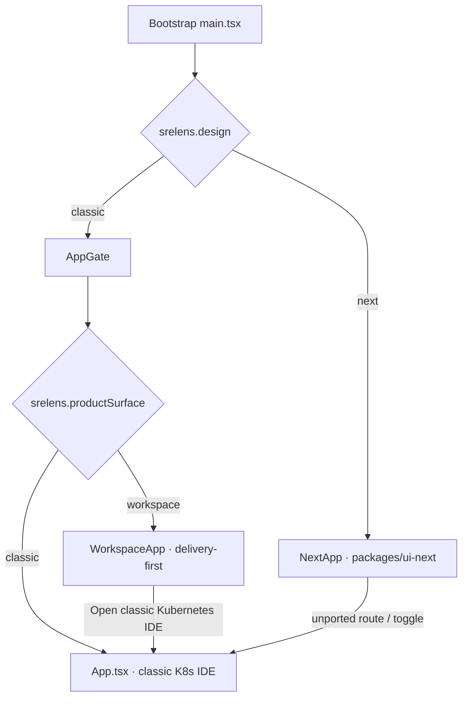
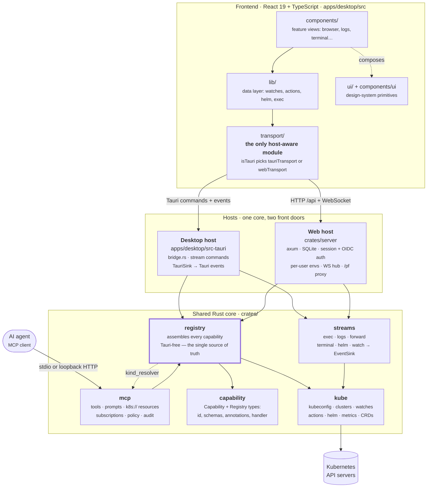

# Developer guide

This guide covers everything you need to build, test, and extend srelens.

## Prerequisites

- **Rust** (stable) — install via [rustup](https://rustup.rs). The toolchain is pinned by `rust-toolchain.toml` (stable + `llvm-tools-preview` for coverage).
- **Node.js 26** is the development default; **Node.js 24 LTS** is also supported. Run `nvm install && nvm use` from the repository root. `.nvmrc` selects the default major for developers and CI/release workflows; `package.json` declares supported majors and `engineStrict` in `pnpm-workspace.yaml` rejects unsupported versions during installation. CI builds, typechecks, and tests both supported majors.
- **pnpm 11+**. Its exact version is pinned by `packageManager` in `package.json`, and pnpm switches to it on its own — don't install a different one alongside it.
- **Tauri v2 system dependencies** — see the [official prerequisites](https://v2.tauri.app/start/prerequisites/) (on macOS: Xcode command-line tools; on Linux: webkit2gtk and friends).
- A kubeconfig with at least one reachable cluster ([kind](https://kind.sigs.k8s.io) or k3d works well for development).
- **Docker** — only if you want to build or run the [web app](#web-mode) locally.

## Getting started

```sh
pnpm install       # installs all workspace JS dependencies
pnpm dev           # runs `tauri dev`: Vite dev server + Rust backend with hot reload
```

The first `pnpm dev` compiles the full Rust dependency tree and takes a few minutes; subsequent runs are incremental.

> **Note:** Cargo build caches embed absolute paths. If you move or rename the repository directory, run `cargo clean` before building again.

### Everyday commands

| Command | What it does |
| --- | --- |
| `pnpm dev` | Launch the desktop app in dev mode |
| `pnpm test` | All JS/TS tests via Vitest, with coverage |
| `pnpm --filter @srelens/desktop test:watch` | Vitest in watch mode |
| `cargo test` | All Rust tests across the workspace |
| `cargo llvm-cov --workspace --summary-only` | Rust tests with a coverage report |
| `pnpm build` | Production frontend build (`vite build`) |
| `pnpm tauri build` | Packaged, installable desktop binaries |
| `scripts/macos/install-local-app.sh` | Install release/debug `.app` into `/Applications`, sign it, drop the build-tree copy so Spotlight does not show a duplicate |
| `pnpm tauri icon apps/desktop/src-tauri/icons/icon.svg` | Regenerate the full app icon set from the source SVG |
| `UPDATE_CATALOG=1 cargo test -p srelens-registry` | Regenerate the committed capability catalog after adding a capability |
| `UPDATE_CATALOG=1 cargo test -p srelens-plugin-host --test schema` | Regenerate the committed extension manifest schema after changing a manifest field |

Live-cluster suites are `#[ignore]`d and need an explicit run — see [Testing standards](#testing-standards).

### Local macOS install (avoid Spotlight duplicates)

`pnpm tauri build` leaves a full bundle at
`target/release/bundle/macos/srelens.app` (and a `.dmg` beside it). That path
has the **same** `CFBundleIdentifier` (`app.srelens.desktop`) as
`/Applications/srelens.app`, so Launchpad / Spotlight list **two** identical
"srelens" entries until the build-tree copy is gone or unindexed.

After a local build you want to click from the Dock / Spotlight:

```sh
pnpm tauri build
scripts/macos/install-local-app.sh
# optional: open -a srelens
```

The script:

1. Copies the release (or debug) `.app` into `/Applications/srelens.app`
2. Signs with `srelens Dev Codesign` (`scripts/macos/sign-dev-app.sh`)
3. Clears quarantine xattrs
4. Writes `target/.metadata_never_index` so Spotlight skips the Cargo output tree
5. Deletes the build-tree `.app` (DMG stays). Use `KEEP_BUNDLE=1` if you still
   need `open target/.../srelens.app` (e.g. perf measurements).

Do **not** leave both `/Applications/srelens.app` and
`target/*/bundle/macos/srelens.app` around for daily use. One identity, one
path.

## Architecture

> **This fork:** three UI surfaces share one capability core — do not conflate
> them. (1) **New design** (`packages/ui-next`, opt-in via `srelens.design=next`).
> (2) **DevOps workspace** (`apps/desktop/src/workspace/`, default product shell
> when design is classic). (3) **Classic Kubernetes IDE** (`App.tsx` +
> `components/`, escape hatch from workspace). Open work:
> [`TODO.md`](../TODO.md). Product rules: [DevOps workspace shell](#devops-workspace-shell-this-fork).
> Design migration: [Classic vs ui-next vs workspace](#classic-vs-ui-next-vs-workspace-migration-map).

### DevOps workspace shell (this fork)

Delivery-first product: work item → change → build → artifact → deployment →
runtime. **Salience** ([concepts](https://clegginabox.github.io/salience-macos/docs/concepts),
[my-work](https://clegginabox.github.io/salience-macos/docs/my-work)) is the
quality bar for UX *and* domain model — joined context, attention/situations,
master-detail density, restrained macOS chrome. Copy the *feel* (hierarchy,
compact rows, one primary narrative). Do not copy branding, logos, or a
pixel-perfect layout.

**Product reference layout:** Home — summary strip + My Work inbox + inline
trace as a maximizable widget mosaic (`HomeMosaic` / `HomeWidget`). Selecting a
delivery fills Trace without leaving My Work. Deliveries — browse list left,
trace detail right, situations on rows. Sidebar tabs (Deliveries, Kubernetes,
…) remain for deeper / alternate views. Converge on that joined unit-of-work
composition, not a wall of disconnected provider widgets. Do not reintroduce
Dockview.

#### Product surfaces

| Surface | Role | Code |
| --- | --- | --- |
| **Primary** | Default on launch; mosaic My Work (summary / inbox / trace + maximize) | `HomeScreen`, `HomeMosaic`, `HomeWidget` |
| **Browse** | Full delivery list + selected trace | `DeliveriesScreen`, `DeliveryTraceScreen` |
| **Contextual** | Runtime depth when needed | `KubernetesExplorerScreen` |

`WorkspaceApp` defaults to `home`. Home and Deliveries keep the selected trace
beside the list; runtime opens only as a contextual drill-down.

#### Naming

- **No “cockpit”** in user-facing copy, routes, or screen titles.
- No scaffolding strings in production UI (`not wired yet`, `Focus (later)`,
  instruction paragraphs in `ScreenHeader` description).

#### What went wrong (2026-09 post-mortem)

1. **Wrong hero screen** — a *provider* mosaic (orphan Jira/GitLab/Jenkins
   panels with no unit-of-work narrative) shipped before Home/Trace polish.
   Dated lesson: joined delivery widgets on Home are intentional; disconnected
   provider walls are not.
2. **Inverted stages** — chrome effects before content density
   and Salience-like master-detail.
3. **Double chrome** — panel headers repeated the screen hierarchy.
4. **Provider errors as the whole panel** — should be partial trace +
   `sourceErrors`, not a full-pane failure wall.
5. **Adapters exist; composition does not** — `jira` / `gitlab` / `bitbucket` /
   `jenkins` + `devops-model` are fine; IA used to read as five tabs without a
   joined Home surface (Home mosaic addresses the composition gap; secondary
   sidebar destinations remain).

Backend/modularity is not the blocker. **Composition, polish, and primary IA**
are.

#### Open backlog

Tracked in [`TODO.md`](../TODO.md) — do not duplicate checklists here.

#### Checks for workspace UI changes

```bash
pnpm --filter @srelens/desktop test -- WorkspaceApp HomeScreen HomeMosaic HomeWidget DeliveriesScreen DeliveryTrace
pnpm --filter @srelens/desktop test -- qualityGates
cargo test --workspace
```

Drive the screen in the desktop app or Vite harness with stubs — green unit tests
alone are not enough for layout work.

### Classic vs ui-next vs workspace (migration map)

srelens currently boots **one of two designs**, and the classic design path then
picks a **product surface**. Testers and contributors mix these up; they are
independent axes.

| Preference | Values | Default | What mounts |
| --- | --- | --- | --- |
| `srelens.design` | `classic` \| `next` | `classic` | Classic → `AppGate`; next → `NextApp` (`@srelens/ui-next`) |
| `srelens.productSurface` | `workspace` \| `classic` | `workspace` | Only when design is classic: delivery shell vs classic K8s IDE |

Switching design reloads the window (`apps/desktop/src/design.ts` /
`switchDesign`). The two stylesheets cannot share a document. Settings →
Appearance exposes the toggle in **both** designs until migration step 11.



#### What already lives in the new design

Authoritative list: `PORTED_SCREENS` in `apps/desktop/src/design.ts` (mirrored by
`SCREENS` / `screenFor` in `packages/ui-next/src/lib/routes.ts`). A route with no
screen registration renders `Placeholder` and offers **Open in classic**.

Broadly ported: Home, cluster overview, workloads, resource lists and details
(`/k/…`), events, logs, port forwards, terminals, Helm, toolbox, topology,
connections / connect, settings, agent, application log, release notes, edit /
new, extension pages.

#### Still classic-richer or classic-only

Track the checklist in [`TODO.md`](../TODO.md#classic-to-ui-next-gap-k8s-ide-migration).
Headline gaps as of the last doc refresh:

- **Resource CommandPalette** — Console `/`: resource search, KindActions drill,
  Recents, Go to kinds/CRDs, Action handoff → ResourceMenu Pending
  (delete/evict/suspend/scale/restart). Caveats: CronJob Run now navigates
  only; shell/forward prefills dialogs via `resourceHandoff` (not auto-start;
  no remotePort from palette).
- **Toolbox** — live under INVESTIGATE Nav (`/toolbox`).
- **ConfigDataEditor** — live for ConfigMap + Opaque Secret inline edit/save.
- **Pod Debug** — live (ephemeral debug container confirm → attach).
- **Node shell** — Overview → Terminals via `offerNodeShell` / createNodeDebugPod.
- **OverviewBodies** — classic `KindBody` set ported to `DETAILS_BODY` (incl.
  Ingress/PVC/PV/HPA/NetPol/SA/RQ/PDB + Endpoints/RBAC/storage/webhooks/…).
  Namespace/CRDs stay GenericBody like classic GenericDetail.
- **Metrics** — live (`METRICS_BODY` / `MetricsBody` for Pod, Node, workloads).
- **Relations** — live (`RelationsBody` for classic WorkloadRelations kinds).
- **Skills CRUD** — Agent rail Manage skills (list/create/edit/save/delete);
  Generate with AI deferred.
- **`/incidents` + Drill** — not classic parity; Nav removed until a product
  feed exists. Object-scoped `DrillCard` waits on that feed (workspace TODO
  **Product: Incidents / Drill**).
- **Bottom Dock** — intentional non-port; dedicated session screens + agent Console.
- **Ask** — next uses `DetailActions` + Console scope, not classic `AssistantDrawer`.
- **Settings** — Layout and cluster identity in next Settings; kubeconfig sources
  under Connections/Connect; DevOps profiles stay in **workspace** Settings.

#### Workspace is not the classic→next checklist

`apps/desktop/src/workspace/` is the delivery-first product (My Work,
Deliveries, Trace, contours). Its Kubernetes explorer still **embeds** classic
`ResourceBrowser` until a workspace-native explorer replaces that embed (see
workspace backlog in `TODO.md`). Do not file “port Deliveries into ui-next” as
K8s IDE parity — that work stays on the workspace backlog.

#### End state (migration step 11)

When next is complete enough to be the only K8s IDE: delete `design.ts`, the
Appearance design toggle, `Placeholder`, the `ported` / `onSwitchToClassic`
injection path, and the classic IDE tree. Until then the toggle is the only
safe way back to a full classic surface — do not remove it early.

---

srelens builds **two hosts on one shared core**. The desktop app (Tauri) and the
headless web server (axum) both assemble the *same* capability registry and drive
the *same* streaming cores; they differ only in how they reach the user — Tauri
commands and events versus HTTP and WebSocket frames.



The two hosts differ only in how they reach the user. Everything below `crates/registry` is shared, and `crates/registry` is deliberately Tauri-free so the headless server binary builds the identical capability set.

### The crates

| Crate | Role |
| --- | --- |
| `crates/capability` | The `Capability` type itself: id, JSON schemas, safety annotations, async handler, and the `Registry` that holds them. No Kubernetes knowledge. |
| `crates/kube` | Everything Kubernetes: kubeconfig discovery and merging, client cache, auth/OIDC resolution, watches, per-resource modules, actions, Helm, metrics, CRDs, toolbox. |
| `crates/streams` | Host-agnostic streaming cores (exec, logs, forward, terminal, helm, watch). Each manager drives a `crates/kube` stream — or, for `terminal` and `helm`, a local PTY/CLI subprocess — and emits into an `EventSink` the host implements: Tauri events on desktop, WebSocket frames on the web. |
| `crates/registry` | **Where capabilities are registered.** Tauri-free on purpose, so the headless server binary builds the identical registry without linking Tauri. Also owns the catalog projection and the MCP `KindResolver`. |
| `crates/mcp` | The MCP server: tools generated from the registry, plus prompts, `k8s://` resources, watch-backed subscriptions, consent policy, token auth, and the audit log. Transports: stdio and loopback HTTP. |
| `crates/server` | The web host: axum router, SQLite (sqlx) store, session + OIDC auth, per-user isolated environments, encrypted kubeconfigs and cluster tokens, WebSocket hub, port-forward proxy. Ships as the `srelens-server` binary. |
| `apps/desktop/src-tauri` | The Tauri shell: window, command bridge, stream commands, updater, settings, MCP wiring. Its `capabilities.rs` is a thin re-export of `crates/registry`. |

### The capability registry (core pattern)

Every backend operation is a `Capability` (`crates/capability`): an id (e.g. `k8s.listPods`), JSON input/output schemas, safety annotations (`read_only`, `destructive`, `requires_confirm`, `sensitive`), and an async handler.

**`crates/registry/src/lib.rs` is the single place capabilities are registered.** It is deliberately Tauri-free: `build_registry()` / `build_registry_with_paths()` produce the same registry for the desktop app and for the headless `srelens-server` binary. `apps/desktop/src-tauri/src/capabilities.rs` only re-exports it.

One registration produces three surfaces:

1. **Tauri** — the UI calls `invoke_capability(id, payload)` through the transport shim.
2. **Web** — the same id is reachable over `/api` in `crates/server`.
3. **MCP** — `crates/mcp` turns each capability into an MCP tool with the same schema.

Four invariants are enforced by tests rather than by review, so "everything is exposed, and nothing mutates without consent" is a build failure when broken:

| Test | Guarantee |
| --- | --- |
| `every_capability_is_mcp_exposed` (`crates/registry`) | The registry and the MCP tool list match exactly. |
| `assert_mutating_capabilities_are_gated` (`crates/mcp/src/completeness.rs`) | Every capability that is not `read_only` is `requires_confirm`. Note the predicate is *mutating*, not *destructive* — a non-destructive capability can still need consent. |
| `capability_catalog_json_is_in_sync` (`crates/registry`) | The committed `packages/core/src/lib/capability-catalog.json` equals the live registry, so the frontend palette audit can cross-check without linking Rust. Regenerate with `UPDATE_CATALOG=1 cargo test -p srelens-registry`. |
| `committed_manifest_schema_matches_the_contract` (`crates/plugin-host/tests/schema.rs`) | The committed `schemas/extension-manifest.v0.1.json` equals `Manifest::schema()`, and Vitest validates every example manifest against it. Regenerate with `UPDATE_CATALOG=1 cargo test -p srelens-plugin-host --test schema`. |
| `extension_inventory_schema_json_is_in_sync` (`crates/registry`) | The committed `packages/core/src/lib/extension-inventory.schema.json` equals the Rust inventory and manifest types, and `extensionTypes.test.ts` holds the `@srelens/core` extension types to its field names and optionality. Regenerate with `UPDATE_CATALOG=1 cargo test -p srelens-registry`. |
| `full_capability_suite` (`apps/desktop/src-tauri/tests/e2e.rs`) | Every registered capability is actually exercised against a live kind cluster, or explicitly excluded with a reason. Runs in the `integration` CI job. |

### Long-lived streams

Watches, pod exec, log tails, terminals, helm operations, and port-forwards don't fit request/response. Their logic lives in `crates/streams`, one manager per stream kind, each emitting into an `EventSink`:

- **Desktop** implements `EventSink` over Tauri events (`apps/desktop/src-tauri/src/sink.rs`); the streams are started by dedicated Tauri commands (`start_resource_watch`, `start_pod_exec`, `start_log_stream`, `start_port_forward`, plus matching stop/input commands).
- **Web** implements it over WebSocket frames (`crates/server/src/ws/`, `crates/server/src/streams.rs`), started through `/api/command/*`.

The frontend side is identical in both cases and lives in `@srelens/core` (`packages/core/src/lib/`: `watch.ts`, `exec.ts`, `logsStream.ts`, `forward.ts`).

### The transport shim

`packages/core/src/transport/` is the only frontend code that knows which host it is running in. `transport.ts` picks `tauriTransport` or `webTransport` at load time based on `isTauri()`, and re-exports one interface (`invokeCapability`, `invokeCommand`, `on`, `subscribe`, …). Everything else — stores, components, tests — depends only on that interface. This is what makes the UI testable in jsdom *and* what makes web mode possible at all, so keep `@tauri-apps/api` imports confined to `packages/core/src/transport/`.

### Persisting application settings

Use `settingsStorage` from `@srelens/core` for every persistent preference,
including the selected design. Application bootstrap awaits
`initializeSettingsStorage()` before choosing the design or mounting React.
The adapter reads a synchronous in-memory mirror and writes to the desktop
settings file or the signed-in web user's SQLite settings. Web bootstrap loads
`GET /api/settings`; writes use the existing per-key settings endpoints.

Do not add direct browser-storage writes for preferences. Legacy browser values
are imported from an explicit allowlist, and removed only after backend writes
succeed. Backend settings take precedence over stale local copies. A backend
initialization failure leaves the app readable but does not redirect writes to
local storage. Before reloading after a preference change, await
`flushSettingsWrites({ throwOnError: true })` and keep the current screen if it
fails. Temporary navigation handoffs and unsaved editor drafts are not settings.

### Running the MCP server

```sh
cargo run -p srelens-desktop --no-default-features -- --mcp-stdio
cargo run -p srelens-desktop --no-default-features -- --mcp-http 127.0.0.1:8765
```

The HTTP transport binds to loopback, requires a bearer token (`crates/mcp/src/auth.rs`, supplied via `SRELENS_MCP_TOKEN` — never a flag, since argv is readable via `ps`), and checks the `Host` header on every route to block DNS rebinding. Gated tools go through an injected `ConfirmPolicy` (`crates/mcp/src/policy.rs`), which receives a `ConsentKind` derived from the capability's annotations: a gated capability that is `read_only` is a `SensitiveRead`, anything else gated is `Destructive`. The desktop app prompts in-app for both; headless runs need `"_confirm": true` on the call plus the matching flag (`--mcp-allow-destructive` or `--mcp-allow-sensitive-reads`) — `_confirm` alone never authorizes anything, and neither flag implies the other.

Beyond tools, the server implements:

- **Prompts** (`crates/mcp/src/prompts.rs`) — canned diagnostic flows, with bodies in `crates/mcp/src/prompts/*.md` as `discover`/`targeted` pairs (pod-crashloop, pod-pending, node-pressure, service-no-endpoints), plus user-authored prompts from a host-supplied directory. A test asserts every tool a prompt names really exists and is on the read-only allowlist.
- **Resources** (`crates/mcp/src/resources.rs`) — `k8s://` URIs resolved through a `KindResolver`. Secrets are deliberately *not* addressable as resources; they stay behind the gated `k8s.getSecret` tool, which is what keeps "the consent gate never fires on a resource read" true.
- **Subscriptions** (`crates/mcp/src/subscriptions.rs`) — watch-backed `resources/subscribe` on both transports: stdio pushes on its stdout, HTTP on the `GET /mcp` SSE stream (`crates/mcp/src/http.rs`, #193), with every watch scoped to the stream that requested it.

Every component fails closed: an `McpServer` whose host wires nothing denies every gated call, resolves no kinds, and refuses every subscription.

See [MCP.md](MCP.md) for the full security model.

## Web mode

srelens also runs as a multi-user web server in a container — same registry, same
streams, different host. `crates/server` owns it, and it ships as its own binary.

```sh
# run the server against the built frontend
pnpm build
SRELENS_DEV_LOGIN=you@example.com \
SRELENS_MASTER_KEY=$(openssl rand -hex 32) \
cargo run -p srelens-server --bin srelens-server -- serve 127.0.0.1:8080 --data ./srelens-data

# or build and run the shipped image
docker compose up --build
```

The frontend is embedded into the binary with `rust-embed`, so `pnpm build` must
run before the server crate is compiled for release.

Things worth knowing before you touch this crate:

- **The server refuses to start without `SRELENS_MASTER_KEY`**, and without either OIDC config or `SRELENS_DEV_LOGIN`. Both are deliberate fail-closed checks, not conveniences.
- **Every user gets an isolated environment** — their own sealed kubeconfigs, their own materialized files under `$SRELENS_DATA/runtime` (tmpfs in production), their own helm home. Anything you add that touches per-user state goes through `users::UserEnvs`, never a process-wide path.
- **Some capabilities are refused on the web surface**: host shell, toolbox installs, and helm `repo`/`plugin` operations, because on a shared container they would run as the shared UID or leak across users. Denials are enforced at *both* layers, never in the UI alone — `WEB_DENIED_CAPABILITIES` in `crates/server/src/api.rs` for the capability surface, and `WEB_DENIED_COMMANDS` / `HELM_DENIED_SUBCOMMANDS` in `crates/server/src/api_command.rs` for the streaming surface.
- **Web mode is single-instance.** SQLite, in-memory OIDC login state, live WebSockets, and port-forwards are all per-process; a second replica breaks logins and streams and risks database corruption.
- OIDC HTTP clients disable redirect following on purpose — the issuer URL can come from a user's kubeconfig, and a redirect-following client turns discovery into an SSRF primitive.

See [docs/WEB.md](WEB.md) for deployment, environment variables, cluster OIDC sign-in, and the full security model.

## Testing standards

Development is **test-driven — this is mandatory, not aspirational**:

1. Write a failing test that motivates the change (red).
2. Make it pass with the simplest implementation (green).
3. Refactor with the tests as a safety net.

**Coverage floors, enforced in CI:**

- TypeScript: **85% lines, 80% branches, 76% functions** (Vitest `thresholds` in the root `vitest.config.ts`).
  Measured across `apps/desktop` and `packages/core` together: the floors were set when all
  frontend code lived in one package, and each alone now sits below one of them. Run with
  `pnpm test` — `pnpm -r test` skips the workspace root and so enforces nothing.
  `src/main.tsx`, the test setup, and `PodTerminal.tsx` (xterm DOM integration, verified live) are excluded.
- Rust: **85% lines** (`--fail-under-lines 85` in CI) — the Tauri runtime shell is excluded from measurement via `--ignore-filename-regex`; the floor is a ratchet and is never lowered.

Never lower either floor.

Test placement conventions:

- Rust: unit tests in `#[cfg(test)]` modules next to the code.
- TypeScript: `Foo.test.tsx` / `foo.test.ts` beside `Foo.tsx` / `foo.ts`. Component tests use Testing Library against the transport shim (mocked), not Tauri.

### Node.js and browser storage in tests

Node.js 25 and later expose their own Web Storage globals. They are not the
per-window storage the frontend uses: without a storage file, Node 26's
`localStorage` getter can throw. Every Vitest project uses `TEST_EXEC_ARGV`
from `vitest.shared.ts` to disable Node Web Storage **in test workers only**,
before jsdom initializes. Browser tests then use jsdom's isolated storage;
Node-only tests have no browser storage. Do not supply a shared
`--localstorage-file` to make tests pass. Application settings still persist
through the backend `settingsStorage` adapter.

### Live-cluster tests

Suites that need a real cluster are `#[ignore]`d so a plain `cargo test` stays fast and offline. Run them explicitly against a kind cluster:

```sh
kind create cluster --name srelens-e2e
export SRELENS_E2E_CONTEXT=kind-srelens-e2e
cargo test -p srelens-desktop --test e2e -- --ignored --nocapture --test-threads=1
cargo test -p srelens-kube --test helm_lifecycle -- --ignored --nocapture --test-threads=1
```

The e2e suite prints `covered N/M capabilities` and fails if any registered capability is neither exercised nor explicitly excluded with a reason — so a new capability cannot land with no end-to-end case.

### Accessibility check

Automated tests catch labels and roles; they cannot tell you whether the app is
usable without a mouse. Run this by hand before a release, and after any change
to navigation, dialogs, or the tab bar.

**Keyboard, no mouse.** Unplug it or sit on your hands.

1. From a fresh launch, `Tab` through the window. Every stop must be visible —
   there is a focus ring on everything focusable, so a stop you cannot see is a
   bug, not a subtlety.
2. Reach a cluster from the hotbar and a resource list from the sidebar using
   only `Tab`, arrow keys, and `Enter`. Collapsible rows announce themselves via
   `aria-expanded` and toggle on `Enter`/`Space`.
3. `Cmd/Ctrl-K` opens the palette; typing filters; `↑`/`↓` and `Enter` run a
   command; `Esc` closes it and returns focus to where you were.
4. `?` opens the shortcut sheet; `Esc` closes it. In a search field, `?` types a
   question mark instead — check that too.
5. Open a resource detail drawer. Focus moves into the panel, and `Esc` closes
   it and hands focus back to the row you opened it from. The drawer is
   deliberately not modal — it sits beside the list rather than over it — so
   `Tab` is free to leave it; that is correct, not a bug.

**Screen reader.** VoiceOver on macOS (`Cmd-F5`), NVDA on Windows, Orca on
Linux. With the rotor / element list:

1. Landmarks list both navigation regions by name: **Clusters** (hotbar) and
   **Cluster resources** (sidebar).
2. Every button announces a name, not "button" alone — icon-only controls carry
   an `aria-label` and their icon is `aria-hidden`.
3. Resource tables announce as tables with column headers, and row navigation
   reads the header with each cell.
4. Opening a dialog announces its title; closing returns you to the trigger.

Anything that fails belongs in an issue with the step number, the assistive
technology, and its version.

## Adding a new capability (walkthrough)

1. **Write the handler test-first** in the right `crates/kube` module (or a new one): a `pub fn <name>_capability(cache: …) -> Capability` returning schemas derived with `schemars` and an async handler.
2. **Register it** in `crates/registry/src/lib.rs` — the Tauri, web, and MCP surfaces all appear automatically.
3. **Annotate safety** — mark it `read_only`, or `requires_confirm` (plus `destructive`/`sensitive` where they apply) so MCP hints and UI confirmations are driven from one place. A mutating capability that is not confirm-gated fails the build. (Web denial is *not* annotation-driven — see step 7.)
4. **Regenerate the catalog** — `UPDATE_CATALOG=1 cargo test -p srelens-registry`, and commit the updated `packages/core/src/lib/capability-catalog.json`.
5. **Add an e2e case** in `apps/desktop/src-tauri/tests/e2e.rs`, or exclude it there with an explicit reason.
6. **Consume it in the UI** — call it through the data layer in `@srelens/core`, never directly from a component.
7. **Consider web mode** — if the capability cannot be safe on a shared multi-user container, add it to `WEB_DENIED_CAPABILITIES` in `crates/server/src/api.rs`.
8. Run `cargo test && pnpm test` and check coverage before opening a PR.

## Continuous integration

`.github/workflows/ci.yml` runs on every push and pull request to `main` (and
the `dev` / `feat/ui-next` branches inherited from upstream), and on manual
dispatch:

- **frontend** — Node 26 and 24: `pnpm typecheck`, `pnpm build`, `pnpm test`
  with the coverage floors, plus the workflow and perf-script tests.
- **backend** — Linux system libraries, `cargo llvm-cov` over the workspace and
  the kind-bound suites, then the 85% line floor.
- **smoke (webdriver)** — PRs only: the real Tauri app through `tauri-driver`.
- **install script** — shellcheck, the installer suite natively and as root.
- **docker image** — builds the image without pushing it.

All must be green.

`.github/workflows/desktop-build.yml` builds unsigned desktop artifacts on
pushes and PRs to `main`, and on manual dispatch: macOS Apple Silicon
(`macos-15`, `.app.zip` + `.dmg`) and Linux x86_64 (`.deb` + `.AppImage`). The
artifacts are named `srelens-desktop-macos-arm64` and
`srelens-desktop-linux-x86_64`, kept 14 days, and published nowhere. Updater
signatures are disabled: CI has no signing key and must not invent one.
The updater points at SmallSpace; CI artifacts do not publish an update feed.
Signed updates require a SmallSpace signing key and matching public key first.

The canonical repository is `1tuz/SmallSpace`. The release pipeline
(`release.yml`, `aur-publish.yml`, `homebrew-publish.yml`) is preserved from
upstream but gated on `github.repository == 'srelens/srelens'`, so it cannot
tag releases, push the GHCR image, or publish distro packages from SmallSpace.
Scorecard still uploads SARIF locally, but publishes its external score only
from the original repository.

### Release signing key (maintainers)

Release assets are GPG-signed by the `sign-artifacts` job, which activates
automatically once `GPG_PRIVATE_KEY` is present and stays dormant otherwise. The
key must be generated on a maintainer's own machine: a release-signing private
key should never be pasted into a chat, an issue, a CI log, or any tool that
retains input.

**0. Check that gpg can prompt for a passphrase.** GnuPG delegates the prompt to
a `pinentry` program, and a missing or misconfigured one fails the key
generation with `agent_genkey failed: No pinentry` before anything is created.

```bash
grep pinentry ~/.gnupg/gpg-agent.conf 2>/dev/null   # what the agent expects
ls -l "$(grep -oE '/\S*pinentry\S*' ~/.gnupg/gpg-agent.conf 2>/dev/null)"
```

If the configured program is missing, install it (`brew install pinentry-mac`
on macOS; your distribution's `pinentry-gtk2`/`pinentry-curses` on Linux) or
point `pinentry-program` at one you do have, then restart the agent so it picks
up the change:

```bash
gpgconf --kill gpg-agent
```

**1. Generate a dedicated key.** Not a personal key — this one only ever signs
srelens releases, so it can be revoked without collateral damage.

```bash
gpg --quick-generate-key "srelens release signing <releases@srelens.com>" ed25519 sign 3y
```

Note the key id it prints (the long hex string); `$KEYID` below refers to it.

**2. Make a revocation certificate and back both up offline.** Do this *before*
the key signs anything. Without the revocation certificate a lost or compromised
key cannot be retired, only abandoned.

> **Write these OUTSIDE the repository.** Both files are key material and a
> `git add -A` will happily commit them. The revocation certificate is the
> dangerous one: it carries no passphrase, so anyone who obtains it can revoke
> the key permanently and irreversibly. The paths below are absolute for that
> reason — do not run these with the repo as your working directory.

```bash
mkdir -p ~/srelens-keys && chmod 700 ~/srelens-keys
gpg --output ~/srelens-keys/revoke.asc --gen-revoke "$KEYID"
gpg --export-secret-keys --armor "$KEYID" > ~/srelens-keys/signing-key.asc
```

Move both to offline media (not this repo, not a cloud drive that syncs to a
workstation), then remove `~/srelens-keys`. If either file ever reaches a
remote, treat the key as spent and generate a new one: purging the commit does
not help, because the revocation certificate stays valid forever.

**3. Add the CI secrets.** The workflow base64-decodes the private key, so it
must be encoded — a raw armored block loses its newlines through the secret
store.

Pipe it straight into `gh`: the key then never lands on disk or in the
clipboard, so there is nothing to commit by accident.

```bash
# Linux
gpg --export-secret-keys "$KEYID" | base64 -w0 \
  | gh secret set GPG_PRIVATE_KEY --repo srelens/srelens

# macOS — BSD base64 spells the wrap option -b; current macOS also accepts -w0,
# but -b 0 works on both old and new.
gpg --export-secret-keys "$KEYID" | base64 -b 0 \
  | gh secret set GPG_PRIVATE_KEY --repo srelens/srelens

gh secret set GPG_PASSPHRASE --repo srelens/srelens   # prompts; stays out of shell history
```

Confirm with `gh secret list --repo srelens/srelens`. Setting them through the
web UI works too, but then the encoded key exists in a file or on the clipboard
for as long as it takes to paste it.

**4. Publish the public half.** `KEYS` is **cumulative** — export the new key
*alongside* every key already in it, never over the top. Someone verifying an
older release still needs the key that signed it, and needs to be able to see
that key's revocation status; overwriting the file strands those releases with
signatures nobody can check.

Build the new file in a scratch keyring holding the archive plus the new key.
`gpg --export` can only emit keys it actually holds, and it does **not** fail
when asked for one it lacks — it exports what it can and exits 0 — so listing
the retired fingerprints on an export from your own keyring silently drops
every key you no longer have, which is exactly the case after a rotation.

```bash
RING=$(mktemp -d) && chmod 700 "$RING"
gpg --homedir "$RING" --import KEYS            # the keys already published
gpg --export "$KEYID" | gpg --homedir "$RING" --import   # plus the new one
gpg --homedir "$RING" --export --armor > KEYS
rm -rf "$RING"

gpg --send-keys --keyserver hkps://keys.openpgp.org "$KEYID"
```

Confirm nothing was lost before committing — the count must have gone up by
one, and the retired fingerprints must still be listed:

```bash
gpg --with-colons --import-options show-only --import KEYS \
  | awk -F: '/^fpr/{print $10}'
```

For the very first key there is nothing to preserve, so `gpg --export --armor
"$KEYID" > KEYS` is enough.

Commit `KEYS`, then update the fingerprint table in
[docs/INSTALL.md](INSTALL.md#verifying-a-download). On a **rotation**, add a
new row rather than editing the old one, and move the `**current**` marker —
the previous row must keep its fingerprint and gain the release range it
covers, or every release it signed becomes unverifiable even though its key is
still in `KEYS`:

```bash
gpg --fingerprint "$KEYID"
```

This step is not cosmetic, and it is enforced. A `Good signature` only proves
the asset matches whichever key the verifier happens to hold; anyone can upload
a key to a keyserver under any name or address. The published fingerprint is
the only thing that ties a signature back to this project.

It is also the **authoritative record of which key is current**: `sign-artifacts`
refuses to sign a stable release unless the key in `GPG_PRIVATE_KEY` matches the
fingerprint in the row marked `**current**` and that key appears in `KEYS`,
unrevoked. A rotation that updates the secret but not the table — or the
reverse — fails the release rather than publishing signatures the instructions
tell users to reject.

**5. Verify the next release.** After the following release completes, download
one asset and its `.asc` and confirm `gpg --verify` succeeds following only the
public instructions — the signing job failing loudly is not proof the signature
is *usable*.

## Conventions

- **Branching** — `main` is SmallSpace's default branch; open PRs against it. The original `srelens/srelens` development branch remains an upstream reference.
- **Commits** — imperative subject line, body explaining *why* when non-obvious. Stable releases are Conventional-Commit-driven, so use `feat(scope):` / `fix(scope):` prefixes.
- **Formatting** — `cargo fmt` for Rust; the existing Prettier-ish style for TS (match surrounding code).
- **UI** — three surfaces: new design (`@srelens/ui-kit` in `packages/ui-next`), classic IDE (`src/components/ui` shadcn/radix, `src/ui`, `src/ui/styles.css`), and the delivery workspace (`apps/desktop/src/workspace/`). Use the owning surface’s tokens; do not mix. Design toggle and remaining classic-only gaps: [migration map](#classic-vs-ui-next-vs-workspace-migration-map) and [`TODO.md`](../TODO.md#classic-to-ui-next-gap-k8s-ide-migration).
- **No direct Tauri imports** outside `src/transport/`.
- **No host-specific logic in `crates/`** — if a change only makes sense for the desktop or only for the web, it belongs in `apps/desktop/src-tauri` or `crates/server`, not in the shared core.
